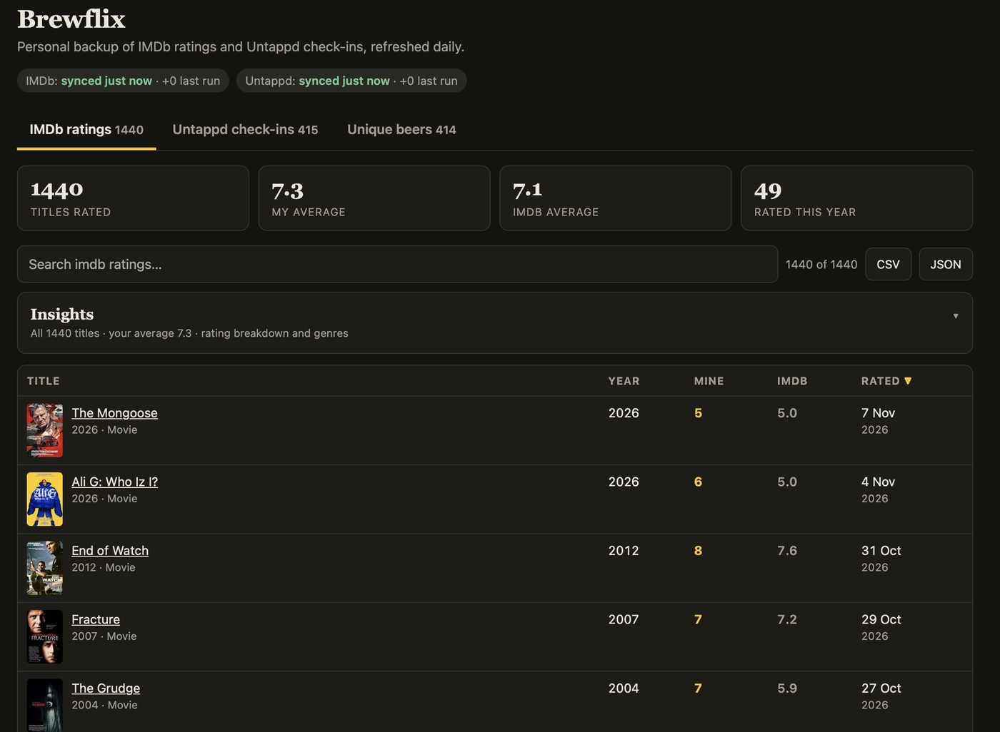
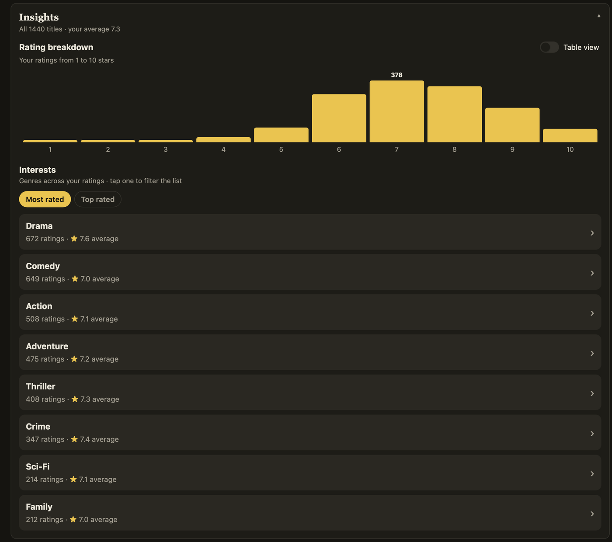
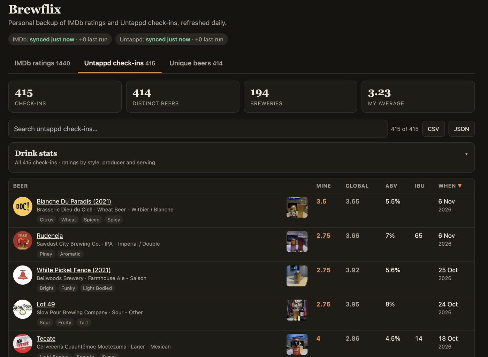
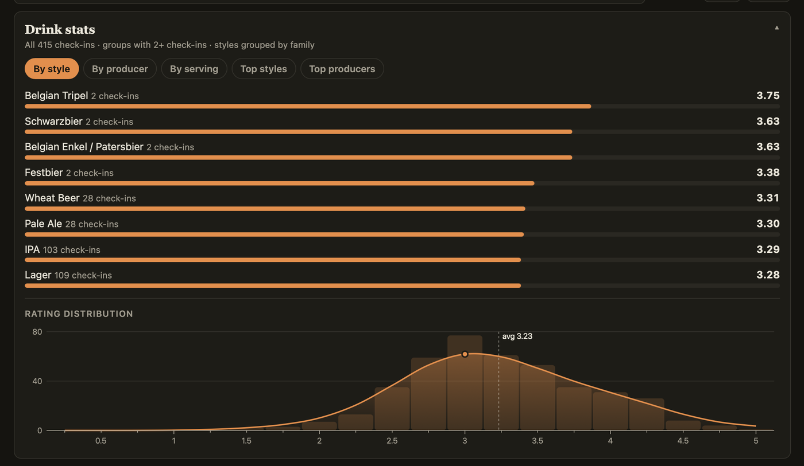
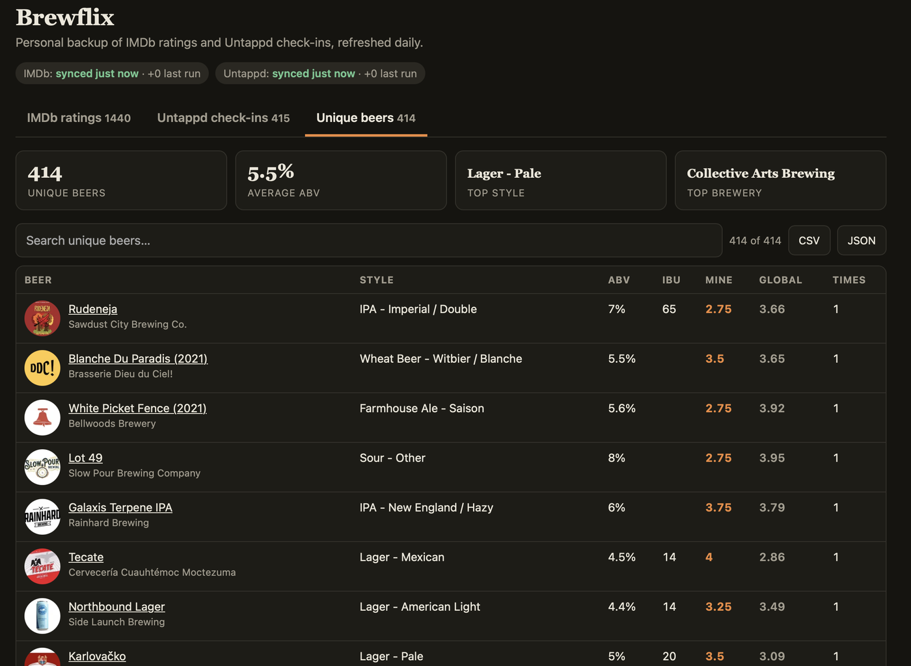
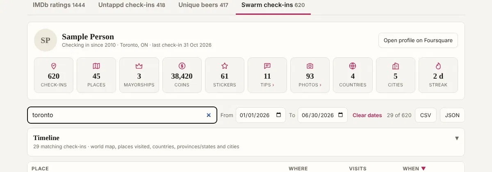
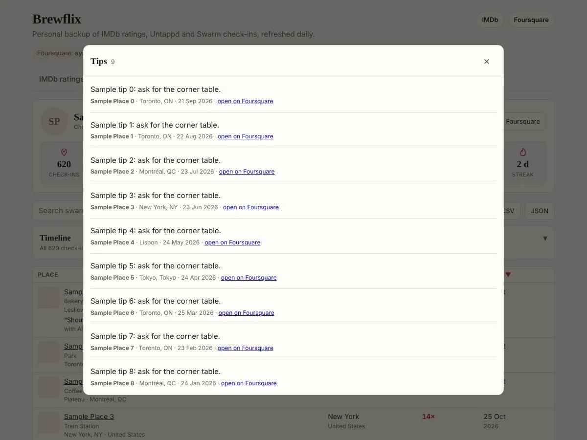

# Brewflix

**Your IMDb ratings, Untappd check-ins and Foursquare/Swarm check-ins, backed
up daily and browsable on your own private website, all on free tiers.**

Brewflix copies your ratings and check-ins into plain JSON and CSV files in your
own GitHub repo every morning, keeps your photos and beer labels in a private
Cloudflare bucket, and gives you a fast little site to search them, with
insights you won't find on either service. If IMDb or Untappd ever change,
paywall or disappear, your history is still yours.



## What you get

**IMDb**
- Every title you've rated, with poster, year, type, director, runtime, your
  rating, IMDb's rating and the date you rated it. Search finds directors too.
  Genres come along if you import IMDb's own export once.
- An **Insights** card: a 1–10 breakdown of your ratings (with a table view)
  and your genres, most rated or top rated. Tap a genre to filter the list.



**Untappd**
- Every check-in, with beer label, brewery, style, ABV, IBU, your rating,
  Untappd's global rating, serving type, your flavour profile tags and your
  photo (tap for full size).
- A **Drink stats** card: ratings by style family, producer and serving type,
  your top styles and producers, and your rating distribution from 0.25 to
  5.00 with a smoothed curve.
- A **Unique beers** list with how many times you've had each one.







**Foursquare / Swarm**
- Every check-in with its place, category, neighbourhood and city, your
  comment, who you were with and your photos.
- A profile card with your counters, and a **Timeline** card: check-ins by
  year, a zoomable map, rankings by country, province/state and city, and a
  sortable list of every place you've visited.
- Set up separately; see [Foursquare / Swarm check-ins](#foursquare--swarm-check-ins).




**Everywhere**
- Links to your IMDb, Untappd and Foursquare profiles at the top of the page.
- Search any tab; the stats cards follow your search (type "IPA" for IPA stats).
- Download any list as CSV or JSON.
- Works on a phone: extra columns fold into the line under each title.
- Light and dark mode follow your device.

## How it works

```
GitHub Actions — daily                               Cloudflare
┌─────────────────────────────────────────┐        ┌────────────────────────────────────┐
│ scraper/run_all.py                      │  push  │ Worker (Workers Builds)            │
│  1. import native exports (imports/)    │ ─────▶ │  site/: static viewer + insights   │
│  2. IMDb + Untappd (browser), Swarm (API)│        │  /photos /thumbs /labels    ▲      │
│  3. merge → backups/*.json + *.csv      │        │  only with an Access token  │      │
│  4. copy photos + labels to R2──────────┼──────▶ │  private R2 bucket ─────────┘      │
│  5. commit (git history = snapshots)    │        │  (no public URL)                   │
└─────────────────────────────────────────┘        └────────────────────────────────────┘
```

- **Scraping:** Python and Playwright drive a real Chromium, reading IMDb's
  page data and Untappd's activity feed. After the first full run, each daily
  run only reads what's new and stops as soon as it reaches items it already
  has.
- **Storage:** records are merged by ID, never replaced, so a blocked or
  partial run can't lose anything. Every daily commit is a dated snapshot you
  can go back to.
- **Website:** a single HTML page with no build step, served as static assets
  by a Cloudflare Worker. The Worker's only code serves your private images.
- **Images:** your check-in photos and beer labels are copied to a private
  Cloudflare R2 bucket as small WebP files with all metadata (EXIF, GPS)
  removed. The site shows your copy first and falls back to the original.

## Privacy and security

Keep your own copy private once it holds check-ins: Untappd check-ins record
where you had each beer, and Swarm check-ins are a location diary (see below).

- **Stored for Untappd:** where you had the beer (the venue's name, such as
  "Untappd at Home" or a bar), so check-ins can be lined up with Swarm.
- **Never stored for Untappd:** where you bought a beer and your check-in
  comments. Check-in times are reduced to the calendar day in your time zone.
- **Images stay private.** They live only in your R2 bucket, never in git. The
  Worker serves them only to visitors signed in through Cloudflare Access, and
  checks the Access token's signature, audience and expiry itself. If Access
  isn't configured, it serves nothing.
- **No secrets in the repo.** Cloudflare keys live in GitHub Actions secrets.
  An optional Untappd login lives only inside your own Codespace and is
  git-ignored.
- **Pushes are checked.** The Codespace script refuses to push if the backups
  contain comments, purchase locations or clock times.
- **Forks and pull requests** can't reach your data or secrets: only a
  read-only test workflow runs for them.

The website itself shows your ratings and check-ins, so protect it with
Cloudflare Access (step 5 below) unless you want it public.

## Set it up for yourself

You need a GitHub account and a free Cloudflare account. Everything can be done
from a browser, including on a phone.

### 1. Copy the repo

Click **Use this template** (or fork), and make your copy **private** if you'd
rather not publish your ratings. Then edit `targets.json`:

- `YOUR_IMDB_USER_ID`: from your IMDb ratings page URL, e.g. `ur1234567` or
  `p.abc123…` in `imdb.com/user/<id>/ratings/`. Your ratings list must be
  public (IMDb → Account settings → Privacy).
- `YOUR_UNTAPPD_USERNAME`: your Untappd username.

Leave a service's placeholders in place to skip it.

### 2. Set your time zone (optional)

Check-in dates use UTC unless you add a repository variable or environment
variable `BACKUP_TZ`, e.g. `America/Toronto` or `Europe/London`. The daily job
runs at 10:17 UTC; change the `cron` line in
`.github/workflows/daily-backup.yml` if you like.

### 3. Run the first backup

Actions tab → enable workflows → **Daily backup** → **Run workflow**. The
first run takes a few minutes. Your data appears in `backups/`.

For your **full IMDb history**, request IMDb's export (Your ratings → ⋮ →
Export), save it as `imports/imdb_ratings.csv` and commit it. The next run
merges it in. Afterwards rename it with a date, e.g.
`imports/imdb_ratings_2026-11-07.csv`, so it isn't re-applied.

### 4. Put the website on Cloudflare

Cloudflare dashboard → **Workers & Pages** → **Create** → import your GitHub
repo, then set:

| Setting | Value |
|---|---|
| Build command | `bash build.sh` |
| Deploy command | `npx wrangler deploy` |
| Path | `/` |
| Preview builds | off |

The Worker name must match `"name"` in `wrangler.jsonc` (`brewflix` by
default). Every daily commit redeploys the site.

If you're not setting up image backups, delete the `r2_buckets` line in
`wrangler.jsonc` first; deploys fail if the bucket doesn't exist.

### 5. Make the site private with Cloudflare Access

In the Worker's settings turn on **Protect with Cloudflare Access**, with a
policy that allows only your email. Then copy two values into
`wrangler.jsonc` → `vars`:

- `ACCESS_TEAM_DOMAIN`: your team domain, e.g. `yourteam.cloudflareaccess.com`
- `ACCESS_AUD`: Zero Trust → Access → Applications → your app → **AUD tag**

These aren't secrets. Images are only served once both are set.

### 6. Back up your photos and labels (optional)

1. Cloudflare → **R2** → enable it (free tier: 10 GB) → create a bucket named
   `brewflix-photos`. Use another name if you like, and change `bucket_name` in
   `wrangler.jsonc` and the `R2_BUCKET` repository variable to match.
2. R2 → **Manage API tokens** → create a token with **Object Read & Write**
   on that bucket only.
3. GitHub → your repo → Settings → Secrets and variables → Actions → add:

   | Secret | Value |
   |---|---|
   | `R2_ACCOUNT_ID` | Cloudflare account ID (shown on the R2 page) |
   | `R2_ACCESS_KEY_ID` | from the token |
   | `R2_SECRET_ACCESS_KEY` | from the token (shown once) |

The next run copies everything. New images are added daily after that.

### 7. Full Untappd history and flavour tags (optional)

Logged out, Untappd only shows your recent check-ins, so the daily job sees
only those. To read your whole history and flavour tags once, while logged in:

1. Your repo → **Code** → **Codespaces** → **Create codespace on main**. It
   includes a small desktop you open in the browser.
2. In the terminal: `bash scripts/untappd_backfill.sh`
3. Open the **Ports** tab → *Browser desktop* (6080) → globe icon →
   **Connect**, password `vscode`. Log in to Untappd in the Chromium window,
   then press Enter in the terminal.
4. It reads every check-in and pushes the results (roughly 4 seconds per
   check-in). Stop the Codespace when it's done.

Your login stays inside that Codespace. If the script ever reports that the
Codespace's history differs from GitHub's, run:

```bash
git fetch origin main && git show FETCH_HEAD:scripts/codespace_resync.sh | bash
```

## Untappd: catching every check-in

Signed out, your Untappd profile shows only your latest 5 check-ins, so on a
night with more than that the daily run would miss some. Two things cover it:

1. **Your RSS feed (main route).** Untappd → Account settings → *View your RSS
   feed*; save that link as the repository secret **`UNTAPPD_RSS_URL`**. It
   lists your latest 25 check-ins. Each run reads it and opens the public page
   of any check-in not yet backed up, for the beer, rating, serving, location,
   photo and flavour tags. Nothing to sign in to, nothing that expires. The
   link contains a private key, so it is never printed in the run log.
2. **A saved sign-in (fallback).** Signed in, the profile shows your whole
   history, so the run walks back until it reaches check-ins already saved.
   That covers more than 25 check-ins between runs, or the feed being down. In
   the Codespace run `bash scripts/untappd_save_signin.sh`; it logs in (on the
   browser desktop, port 6080) if needed and stores the sign-in as the secret
   **`UNTAPPD_STORAGE_STATE`**. Untappd ends sessions now and then: run it with
   `--relogin` when the site says so. The Codespace backfill refreshes it too.

If more than 25 check-ins arrive between runs and the saved sign-in isn't
working, the run still succeeds but the Untappd status on the site turns red
with *may be missing check-ins*; the Codespace backfill fills the gap.

## Foursquare / Swarm check-ins

Unlike the other two services this one uses Foursquare's API, not a browser,
so it needs a token once and then runs on its own every day.

**What is saved**

| File | One row per | Fields |
|---|---|---|
| `backups/foursquare_checkins.json/.csv` | check-in (`checkin_id`) | place, category, neighbourhood, city, province/state, country, address, coordinates, your comment, friends you tagged, date and time at the place, photo URLs, backup markers |
| `backups/foursquare_places.json/.csv` | place (`venue_id`) | name, category, location, number of check-ins, first and last visit |
| `backups/foursquare_tips.json/.csv` | tip you wrote (`tip_id`) | text, place, city, date, link, photo URL |
| `backups/foursquare_profile.json` | — | name, join date and counters (mayorships, tips and so on when Foursquare still reports them; the rest are counted from your check-ins) |

**One-time setup**

1. Create a free project at <https://foursquare.com/developers>. In its OAuth
   settings add the redirect URL `https://localhost/`; note the Client ID and
   Client Secret.
2. Open a Codespace on this repo (Code → Codespaces; the same one used for the
   Untappd backfill is fine) and run `python scripts/foursquare_token.py` in
   its terminal. Open the link it prints and approve. Your browser then says
   it can't connect to "localhost": that is expected. Copy the address it shows
   (`localhost/?code=…`) and paste it into the terminal. Nothing runs on your own computer; a phone browser works.
3. The script saves the token as the repository secret **`FOURSQUARE_TOKEN`**.
   If the Codespace isn't allowed to, it shows the token once so you can paste
   it at Settings → Secrets and variables → Actions. Stop the Codespace after.
4. Put your profile link in the `foursquare` section of `targets.json`.
5. Actions → Daily backup → Run workflow with *full* ticked. That walks your
   whole history; daily runs afterwards read only what is new.

Actions → **Foursquare check** → Run workflow lists which Foursquare endpoints
still answer for your account (useful when a counter such as mayorships or
coins is missing). It prints field names and counts only, never your
check-ins or the token. In a public repo that run's log is public too.

**Foursquare's own data export** (Foursquare → Settings → request your data):
drop the unzipped folder at `backups/foursquare_export/`, or the file as
`backups/foursquare_export.zip` (`imports/` works too). Every run merges its
`checkins*.json` files in: check-ins the API didn't return are added, and for
ones already backed up only empty fields are filled, so the API's values are
never overwritten. The export stays where you put it as the raw copy, and it
is not published on the site. Leave photo folders out of the repo; photos are
fetched by link into the private bucket instead.

**The Swarm tab** has a profile card (check-ins, places, mayorships, coins,
stickers, tips, photos, countries, cities, longest streak; a counter Foursquare
doesn't report is left out), a searchable list (place, category, where, your
comment, who you were with, your photos), and a *Timeline* card that starts
closed: check-ins by year, a world map with heat spots that turns into one dot
per place as you zoom in, rankings by country, province/state and city (tap
one to filter), and a sortable table of every place visited.

Tap the **Tips** or **Photos** counter on the profile card to see all of your
tips, or every check-in photo in one grid (tap a photo for full size). The
**From** and **To** date boxes beside the search narrow the list, and the
Timeline with it, to a date range; the Untappd check-ins tab has them too.

**Privacy.** This is a location diary, so it is treated more strictly than the
rest:

- The check-in files are served only after the Worker has verified a
  Cloudflare Access token, like photos. Without Access set up the tab stays
  empty rather than public.
- Likes and other people's comments are never stored. Friends you tagged are.
- Photos are re-encoded without EXIF or GPS data and kept only in the private
  bucket.
- The map loads its street tiles from OpenStreetMap, and only once you open
  Timeline. OpenStreetMap's servers then see which map areas you look at and
  this site's address, not your check-ins.
- **Keep your copy of this repo private once it holds `backups/foursquare_*`.**
  Those files say where you have been and when.

**If it stops working:** a rejected token turns the run red and the site shows
"last run failed" with the date of the last good copy; make a new token and
update the secret. If the run log warns that Foursquare reports more check-ins
than are stored, run once with *full* ticked or add the data export.

## Files

| Path | What it is |
|---|---|
| `backups/imdb_ratings.json/.csv` | one row per rated title |
| `backups/untappd_checkins.json/.csv` | one row per check-in |
| `backups/untappd_beers.json/.csv` | one row per unique beer |
| `backups/foursquare_*.json/.csv` | Swarm check-ins, places and profile |
| `backups/status.json` | last success / error per service, shown on the site |
| `scraper/` | `run_all.py` (entry point), `imdb.py`, `untappd.py`, `foursquare.py`, `photos.py`, `normalize_exports.py`, `common.py` |
| `site/index.html` | the whole website (`site/vendor/` holds the Leaflet map library) |
| `worker/index.js` | serves private images and Swarm data behind Cloudflare Access |
| `scripts/` | Codespace helpers for the Untappd backfill; Foursquare token and probe scripts |
| `tests/` | offline end-to-end tests against fixture pages |

## Configuration

| Setting | Where | Default |
|---|---|---|
| `UNTAPPD_RSS_URL` | GitHub secret | Untappd feed link; without it only the latest 5 check-ins are seen signed out |
| `UNTAPPD_STORAGE_STATE` | GitHub secret | saved Untappd sign-in, the fallback |
| `FOURSQUARE_TOKEN` | GitHub secret | Swarm backup skipped when missing |
| `FSQ_PHOTOS_PER_RUN` | env | `600` Swarm photos copied per run |
| `BACKUP_TZ` | env / repo variable | `UTC`: day used for check-in dates |
| `IMDB_DETAILS_PER_RUN` | env | `60` titles looked up per run for missing director/runtime |
| `UNTAPPD_DETAILS_PER_RUN` | env | `120` check-in pages read per run for flavour tags |
| `PHOTOS_PER_RUN` / `LABELS_PER_RUN` | env | `600` / `1000` images copied per run |
| `R2_*` secrets, `R2_BUCKET` variable | GitHub | image backup off when missing |
| `ACCESS_TEAM_DOMAIN`, `ACCESS_AUD` | `wrangler.jsonc` | images refused when empty |
| `DETAILS_VERSION` | `scraper/untappd.py` | bump to re-read every check-in page |

## Running locally

```bash
pip install -r requirements.txt && python -m playwright install chromium
python scraper/run_all.py                          # same as the daily job
python scraper/run_all.py --only untappd --full --headful
python -m pytest -q tests/                         # offline end-to-end tests
```

The tests drive the real Playwright scrapers against fixture pages that mimic
both sites. They cover pagination, incremental runs, export import, date
trimming, flavour parsing, metadata stripping and the image backup.

## When something breaks

- **A failed run** turns red in Actions and GitHub emails you. The site shows
  "last run failed" with the date of the last good copy; saved data is
  untouched.
- **Blocked by a bot check:** run the job from a Codespace with `--headful`
  and solve it in the browser desktop.
- **A site changed its layout:** save the live page into `tests/fixtures/`,
  update the selectors in `scraper/imdb.py` or `scraper/untappd.py` until the
  tests pass. For flavour tags, adjust `parse_flavors` and bump
  `DETAILS_VERSION`.
- **"Photos: R2 not configured"** in the run log: an `R2_*` secret is missing
  or misnamed.
- **Your images aren't showing:** you're not signed in through Access, the
  Access values in `wrangler.jsonc` don't match your Access app, or the image
  hasn't been backed up yet. The site shows the original image meanwhile.
- **Scheduled runs stopped:** GitHub pauses scheduled workflows in public
  repos after 60 days without activity. Re-enable *Daily backup* in Actions.

## Changelog

Every change is listed in [`CHANGELOG.md`](CHANGELOG.md), one entry per
commit.

## Notes

- This scrapes your own public pages for personal backup. Keep the daily
  schedule gentle, and respect IMDb's and Untappd's terms.
- Free-tier headroom: a few Actions minutes a day, a few tens of MB of R2's
  10 GB, and one Worker request per image view (100,000 a day free).
- MIT licensed.
